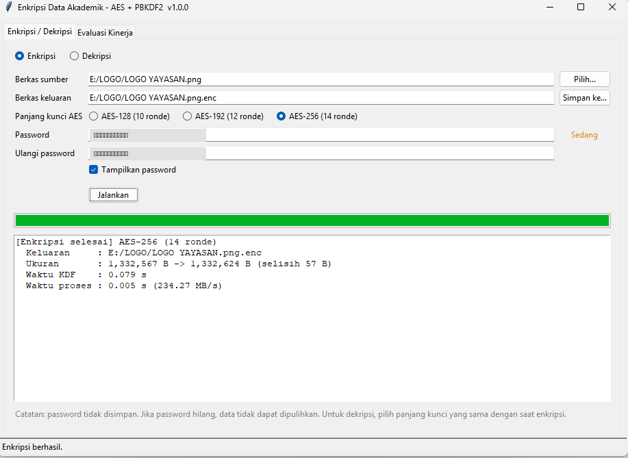
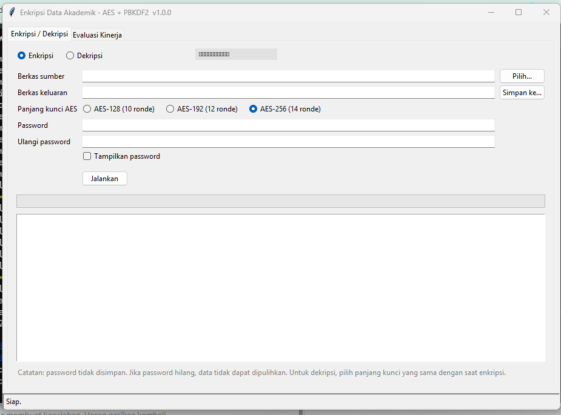

# Aplikasi Enkripsi Data Akademik Desktop (AES + PBKDF2)

Implementasi aplikasi pada penelitian **"Pengembangan dan Evaluasi Aplikasi Enkripsi Data
Akademik Desktop Menggunakan AES dengan Manajemen Kunci Berbasis Password"**
(*Journal of Artificial Intelligence and Engineering Applications*, Vol. 5 No. 3, 2026,
DOI: [10.59934/jaiea.v5i3.2374](https://doi.org/10.59934/jaiea.v5i3.2374)).

## Tampilan Aplikasi

| Enkripsi / Dekripsi | Evaluasi Kinerja |
|---|---|
|  |  |

## Fitur

- Enkripsi & dekripsi berkas dengan **AES-128, AES-192, AES-256** (mode CBC, padding PKCS7).
- **PBKDF2-HMAC-SHA256** (600.000 iterasi, salt acak 32 byte) untuk menurunkan kunci dari password.
- IV acak 16 byte setiap enkripsi; pemrosesan *streaming* (aman untuk berkas besar).
- Tab **Evaluasi Kinerja** yang mengukur: throughput (MB/s), waktu proses, entropi ciphertext,
  *avalanche effect*, overhead ukuran berkas, penggunaan CPU & RAM, dan verifikasi integritas
  (SHA-256). Hasil dapat diekspor ke CSV.
- Mode GUI (Tkinter) dan mode CLI.

## Instalasi

Butuh Python 3.10+ (Tkinter sudah termasuk di instalasi Python Windows/macOS;
di Linux: `sudo apt install python3-tk`).

```bash
git clone https://github.com/USERNAME/aes-akademik.git
cd aes-akademik
python -m venv .venv
# Windows: .venv\Scripts\activate    |  Linux/macOS: source .venv/bin/activate
pip install -r requirements.txt
```

## Menjalankan

```bash
python main.py                                   # GUI
python main.py encrypt  nilai.xlsx -k 256        # CLI enkripsi
python main.py decrypt  nilai.xlsx.enc -k 256    # CLI dekripsi
python main.py bench    a.pdf b.docx             # evaluasi kinerja
```

> Saat dekripsi, panjang kunci harus sama dengan saat enkripsi.

## Format berkas `.enc`

```
| SALT (32 B) | IV (16 B) | CIPHERTEXT AES-CBC (kelipatan 16 B, PKCS7) |
```

Overhead ukuran berkas = 32 + 16 + padding (1–16 B) = **maksimum 64 byte**, konstan
berapapun ukuran berkas asli.

## Pengujian

```bash
pytest -q
```

## Membuat executable (.exe)

```bash
pip install pyinstaller
pyinstaller --onefile --windowed --name EnkripsiAkademik main.py
```
Hasil ada di folder `dist/`.

## Catatan keamanan

- Password tidak disimpan; **jika hilang, data tidak dapat dipulihkan**.
- Mode CBC menjamin kerahasiaan tetapi **tidak menjamin keaslian/integritas** (tidak ada MAC).
  Untuk produksi, pertimbangkan AES-GCM atau menambahkan HMAC (menambah overhead ukuran).
- Gunakan password panjang (≥ 12 karakter) agar tahan serangan *brute-force*.

## Lisensi

MIT. Lihat berkas [LICENSE](LICENSE).
